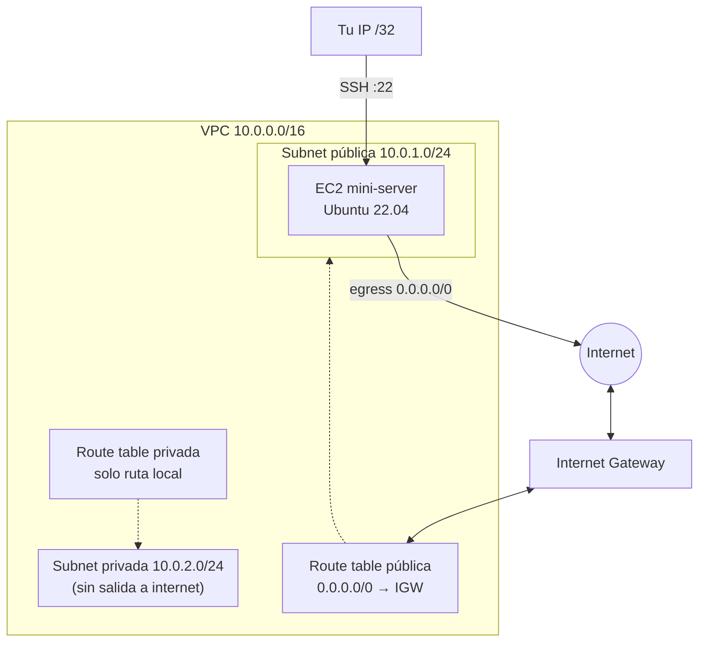

# Mini Proyecto Terraform — Nivel 1 (Base AWS)

Proyecto de práctica de Terraform / IaC sobre AWS: una VPC con subnet pública y
subnet privada, Internet Gateway, Security Group restringido por IP, y una
instancia EC2 accesible por SSH.

Hecho como ejercicio de aprendizaje (Nivel 1 de un plan de estudio hacia roles
DevOps/Cloud Architect junior), no pensado para producción.

## Qué crea

- **VPC** (`10.0.0.0/16`) con DNS support/hostnames habilitado.
- **Subnet pública** (`10.0.1.0/24`) con ruta a internet vía Internet Gateway.
- **Subnet privada** (`10.0.2.0/24`) sin ruta de salida a internet (sin NAT Gateway).
- **Internet Gateway** + route table pública asociada a la subnet pública.
- **Route table privada** sin rutas adicionales (solo la ruta local que añade AWS).
- **Security Group** que permite SSH (22) únicamente desde tu IP (`/32`); egress abierto a todo.
- **Key pair** gestionado por Terraform a partir de una clave pública local.
- **Instancia EC2** (Ubuntu 22.04, resuelto vía `data "aws_ami"`, siempre la AMI más reciente) en la subnet pública.

## Arquitectura



## Estructura

```
main.tf             # provider + todos los resources/data sources
variables.tf         # declaración de variables
outputs.tf           # ip pública, id de instancia, id de VPC
terraform.tfvars      # valores locales (NO se sube a git)
```

## Requisitos previos

- [Terraform](https://developer.hashicorp.com/terraform/install) instalado.
- [AWS CLI](https://docs.aws.amazon.com/cli/latest/userguide/getting-started-install.html) instalado y configurado (`aws configure`) con un **usuario IAM** (nunca con las claves del usuario root).
- Un par de claves SSH generado localmente, fuera de este repo:
  ```powershell
  ssh-keygen -t ed25519 -f "C:\ruta\que\quieras\mini-terraform-key" -C "mini-proyecto-terraform"
  ```

## Variables a definir

Declaradas en `variables.tf`. Las que no tienen `default` hay que ponerlas en `terraform.tfvars`:

| Variable | Default | Descripción |
|---|---|---|
| `region` | `eu-west-1` | Región de AWS |
| `vpc_cidr` | `10.0.0.0/16` | CIDR de la VPC |
| `subnet_cidr` | `10.0.1.0/24` | CIDR de la subnet pública |
| `private_subnet_cidr` | `10.0.2.0/24` | CIDR de la subnet privada |
| `instance_type` | `t2.micro` | Tipo de instancia EC2 |
| `my_ip` | *(sin default, obligatoria)* | Tu IP pública en formato `x.x.x.x/32`, para el Security Group |
| `public_key_path` | *(sin default, obligatoria)* | Ruta local a tu clave pública SSH (`.pub`), fuera del repo |

Ejemplo de `terraform.tfvars` (fichero local, no versionado):

```hcl
my_ip            = "203.0.113.10/32"   # ejemplo: usa TU IP pública real, no esta
public_key_path  = "C:/ruta/a/tu/clave/mini-terraform-key.pub"
```

> `203.0.113.10` pertenece al rango `TEST-NET-3` (RFC 5737), reservado para
> documentación — no es una IP real. Nunca pongas tu IP pública real en un
> fichero que vaya a subirse a un repo público; `terraform.tfvars` ya está en
> `.gitignore` precisamente por esto.

Tu IP pública se puede consultar con:
```powershell
(Invoke-RestMethod ifconfig.me)
```

## Uso

```powershell
terraform init       # descarga el provider de AWS
terraform validate   # comprueba sintaxis y referencias, sin llamar a AWS
terraform plan        # muestra qué se va a crear/cambiar, sin aplicar nada
terraform apply       # crea los recursos (pide confirmación con "yes")
```

Tras el `apply`, los outputs muestran la IP pública y el id de la instancia:

```powershell
terraform output
```

Conectar por SSH:
```powershell
ssh -i "C:\ruta\a\mini-terraform-key" ubuntu@<mini_server_public_ip>
```

## Limpieza

Este proyecto crea recursos reales en AWS, dentro del free tier en cuentas
nuevas (sin NAT Gateway, que sí tendría coste por hora incluso parado). Ojo:
desde 2024 AWS también cobra por las IPv4 públicas asignadas a instancias en
ejecución, aunque las cuentas nuevas tienen horas gratuitas incluidas — no
asumas que todo lo que no sea la EC2 es gratis indefinidamente. Para no dejar
nada corriendo:

```powershell
terraform destroy
```

## Pendiente / mejoras futuras

- [ ] Restringir el `egress` del Security Group (ahora mismo permite todo el tráfico saliente) a los puertos mínimos necesarios (DNS 53, HTTP 80, HTTPS 443, NTP 123).
- [ ] Quitar el `default` de `region` para obligar a elegirla explícitamente.
- [ ] Nivel 2: NAT Gateway para la subnet privada, módulos, remote state.

## Problemas encontrados

- **Síntoma**: `terraform plan` fallaba con un error de credenciales inválidas(se copio con "_" de mas). **Causa**: problema con la Secret Access Key configurada. **Solución**: se optó por regenerar las claves en IAM y volver a correr `aws configure`.
- **Síntoma**: tras el `apply`, no se veía la instancia en la consola de AWS. **Causa**: la consola estaba en otra región distinta a `eu-west-1`. **Solución**: cambiar el selector de región arriba a la derecha.
- **Síntoma**: no se podía hacer SSH pese a tener el SG bien configurado. **Causa**: la instancia se había creado sin `key_name`, sin ningún par de claves asociado. **Solución**: crear `aws_key_pair` y añadir `key_name` al `aws_instance` (esto fuerza un `destroy and recreate`, al ser un atributo fijado en el momento del lanzamiento).

## Seguridad / notas de diseño

- `terraform.tfstate`, `*.tfvars` y `.terraform/` están en `.gitignore` — nunca se suben a git porque pueden contener IPs, IDs de cuenta o valores de variables sensibles.
- El acceso SSH está limitado a una única IP `/32`, no abierto a `0.0.0.0/0`.
- Las credenciales de AWS usadas son de un usuario IAM dedicado (`terraform-cli`), no del usuario root de la cuenta.
